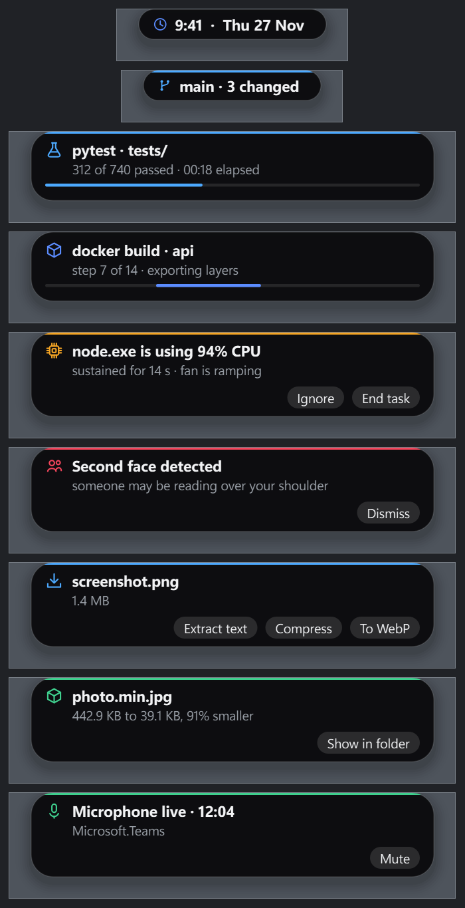
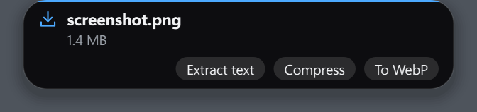

# Adaptive Dynamic Island for Windows

A context-aware desktop overlay that anchors under the laptop webcam and
changes what it shows based on what you are actually doing.



Windows already has a clipboard history, an offline text extractor and a
task manager. This is not another re-implementation of those. It is built
around the three things Windows does not have.

**A Live Activity API.** Any script, build, test run or download can push
live progress into the island over a local socket, which is what the
Dynamic Island is actually for on iOS and what every Windows clone leaves
out.

```
island run --id tests --title "pytest" -- pytest -q
```

**Signal-driven context.** The island reacts to operating system events,
not to a timer polling process names. Meetings are detected from the
Windows microphone consent store, so Teams, Zoom, Discord, Slack huddles
and a Google Meet tab in any browser all work without being on a list.

**Camera-aware privacy sensing.** Optional shoulder-surfing detection that
checks whether another application already owns the webcam before it ever
opens the device, so it cannot fight your video call for the camera.

Everything runs locally. No cloud APIs, no accounts, no telemetry.

## How it is built

Every feature publishes the same `IslandContent` object into a priority
arbiter, and the arbiter hands exactly one winner to the window. The window
knows nothing about Git, webcams or CPU load, so adding a feature cannot
break the animation and conflicts are resolved by stated policy rather than
by whichever timer fired last.

```
 providers                      arbitration                   presentation
┌────────────────────┐         ┌──────────────┐         ┌───────────────────┐
│ ambient clock      │         │              │         │                   │
│ context engine     │ publish │   Content    │ single  │   IslandWindow    │
│ live activity API  ├────────►│   Arbiter    ├────────►│  one paintEvent   │
│ system sentinel    │Island   │  priority +  │ content │  one morph path   │
│ privacy guard      │Content  │  expiry      │ signal  │                   │
│ user plugins       │         │              │         │                   │
└────────────────────┘         └──────────────┘         └───────────────────┘
```

[docs/architecture.md](docs/architecture.md) explains the arbitration
policy, the event-driven OS integration, the threading model and the
performance budgets.

## Status

Early development, and honest about it.

| Area | State |
|---|---|
| Window engine, morph animation, themes | working |
| Screen anchoring to the built-in panel | working |
| Live Activity API and `island` CLI | working |
| Context profiles: meeting, developer | working |
| System tray, diagnostics, settings | working |
| Drop-to-Action OCR, compression, conversion | working |
| Clipboard stack with secret masking | not started |
| System and network alerts | not started |
| Privacy guard | not started |
| Plugin loader | not started |
| Installer | not started |

## Requirements

- Windows 10 or 11
- Python 3.12 to run from source

## Running from source

```
py -3.12 -m venv .venv
.venv\Scripts\python.exe -m pip install -r requirements.txt
.venv\Scripts\python.exe main.py
```

The island appears at the top of the built-in display and a tray icon
appears in the notification area. The tray menu has feature toggles, theme
switching and a diagnostics report that shows which screen it anchored to
and whether the OS hooks installed.

Optional feature packs are installed separately, so the base process stays
inside its memory budget:

```
.venv\Scripts\python.exe -m pip install -r requirements-ocr.txt
.venv\Scripts\python.exe -m pip install -r requirements-vision.txt
```

## Pushing a live activity

See [docs/live-activities.md](docs/live-activities.md) for the full
protocol. The short version:

```
island push build "docker build · api" --progress 0.4 --detail "step 7 of 14"
island done build --status ok --detail "built in 42s"
```

From Python, with no Qt dependency:

```python
from ipc.client import activity

with activity("build", "docker build · api", glyph="cube") as act:
    for step, total in steps():
        act.update(progress=step / total, detail=f"step {step} of {total}")
```

If the island is not running, every call is a silent no-op. A build must
never fail because an overlay is closed.

## Drop to action

Drag files onto the island and it offers the operations that actually
apply to them.



- **Extract text** runs offline OCR on an image, or reads the text layer
  of a PDF, and puts the result on the clipboard.
- **Compress** re-encodes images and PDFs.
- **To WebP** converts images.

Two rules the implementation holds to:

**Your file is never touched.** Every output is written beside the
original with a fresh name. Nothing is overwritten and nothing is deleted,
because dropping something on a floating overlay is easy to do by accident.

**A file is never made worse.** If a compressed output comes out larger
than its input, which happens with already-optimised files, the output is
discarded and the island says the file was already optimal.

OCR needs the optional feature pack. Without it the other actions still
work and the island says why text extraction is unavailable.

## Themes

Themes are JSON files in `config/themes/`, or your own in
`%APPDATA%\AdaptiveIsland\themes\`. A theme may set as little as one
colour; everything it leaves out falls back to the built-in defaults, and a
malformed file logs a warning instead of stopping the island from starting.

Colours, corner radii, padding, animation duration and the easing curve are
all themeable, including a custom cubic bezier.

## Development

```
.venv\Scripts\python.exe -m pip install -r requirements-dev.txt
.venv\Scripts\python.exe -m pytest tests     # unit tests
.venv\Scripts\python.exe -m ruff check .     # lint
.venv\Scripts\python.exe scripts/preview.py  # render every UI state to build/preview/
.venv\Scripts\python.exe scripts/smoke.py    # start the real app, verify, exit
.venv\Scripts\python.exe scripts/e2e_activity.py  # drive the real CLI against the app
.venv\Scripts\python.exe scripts/e2e_drop.py      # drive a real drop through the app
.venv\Scripts\python.exe scripts/check_media.py   # OCR, compression and conversion
.venv\Scripts\python.exe scripts/measure.py       # check the performance budgets
```

`scripts/preview.py` renders every island state offscreen, so UI changes
are reviewable in a pull request and a painting regression fails CI rather
than waiting for someone to notice on screen.

## License

MIT. See [LICENSE](LICENSE).
