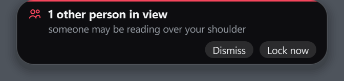

# Privacy guard

Optional shoulder-surfing and walk-away detection, using the webcam the
island already sits beneath.

This is the feature with the most ways to go wrong, so most of the design
is restraint. A camera feature that is annoying gets switched off, and a
switched-off feature protects nobody.



## Setting it up

It needs two things that are not installed by default, both deliberate.

```
.venv\Scripts\python.exe -m pip install -r requirements-vision.txt
.venv\Scripts\python.exe scripts/fetch_yunet.py
```

Then enable **Privacy guard (camera)** in the tray menu.

The face model is a 230 KB file from the OpenCV Zoo. It is not committed
to this repository, because a binary blob in a source tree is something
nobody reads or diffs. The fetch script downloads it on request and
verifies its SHA-256 before writing it. **The island never downloads
anything on its own.** A background overlay that reaches out to the
internet unprompted is the opposite of what this project is for.

Check it works on your machine:

```
.venv\Scripts\python.exe scripts/check_vision.py
```

That opens the camera for a few seconds, prints how many faces it sees
each second, and closes it again. Nothing is saved.

## When the camera is actually open

Almost never, which is the point.

The guard arms only when one of these is true:

1. The foreground window is a process in `privacy.sensitive_processes`.
   The default list is password managers, because the moment a vault is
   open is exactly when a second pair of eyes matters.
2. You switched on **Watch now** in the tray.

Any other time, the device is closed and the hardware light is off.

It also yields the camera. Before arming, and continuously while armed,
the guard reads the Windows capability consent store to see whether
another application is using the webcam. If one is, it does not arm; if
one starts while it is armed, it disarms immediately. Taking the camera
away from a video call would be a far worse outcome than missing a
shoulder surfer, so that check outranks every other arming reason.

While the camera is open the island shows a "watching" indicator, at the
lowest priority so it never takes over the screen. Windows shows its own
camera indicator too, but an overlay that can open your webcam should say
so in its own interface rather than relying on you noticing a tray icon.

## What it does when it sees something

**Two or more faces** raises a shoulder-surfing warning offering **Lock
now** and **Dismiss**.

**No face for a while** raises a walk-away warning offering the same two
buttons. Set `walk_away_seconds` to 0 to switch this off.

Both need several consecutive frames agreeing before anything appears,
and several agreeing frames before a warning clears. One odd frame can
neither interrupt you nor silence a real warning. That hysteresis is the
single most important detail in the feature: without it, a reflection or
a poster on the wall interrupts you once, and you disable the guard.

Dismissing a warning silences warnings for two minutes. Without a
cooldown, dismissing something that is still true makes it reappear
instantly, which teaches people to turn the feature off rather than use
it.

**It never locks anything by itself.** Walk-away offers a button and
stops there. A false negative that locked a machine mid-sentence would do
more damage in a day than this feature prevents in a year.

## What leaves the camera

A face count and a size ratio. That is all.

Frames are read, counted and discarded inside one worker thread. No image
is stored in memory beyond the moment it is counted, written to disk,
shown in the interface, or sent anywhere. There is no network code in this
feature at all.

## The detector

YuNet, a small CNN run through OpenCV's `FaceDetectorYN`, at the score
threshold OpenCV itself recommends. Detection costs about 3 milliseconds
per frame at one frame per second, so roughly 0.3% of one core while
armed, and nothing at all while not.

There is deliberately no fallback detector. The obvious one is a Haar
cascade, which false-positives on bookshelves, patterned curtains and
face-like arrangements of anything. For a feature whose entire job is to
interrupt you, a detector that cries wolf is worse than no detector.
Modern OpenCV builds no longer ship the cascade files anyway, so the
choice is not even a trade-off any more. Without the model the guard
refuses to arm and says why.

## Settings

Under `privacy` in `%APPDATA%\AdaptiveIsland\settings.json`:

| Key | Default | Meaning |
|---|---|---|
| `sensitive_processes` | password managers | Apps that arm the guard |
| `frames_per_second` | 1.0 | Sampling rate while armed |
| `faces_to_warn` | 2 | How many faces counts as "not alone" |
| `confirm_frames` | 3 | Agreeing frames needed to warn |
| `clear_frames` | 2 | Agreeing frames needed to clear |
| `walk_away_seconds` | 60 | 0 disables walk-away entirely |
| `dismiss_cooldown_seconds` | 120 | How long a dismissal lasts |

## Honest limits

It detects faces, not attention. Someone looking at their phone beside
you counts; someone reading your screen in a mirror does not.

It sees only what the webcam sees. A person behind you and to one side
is outside a typical 70-degree field of view.

It is not a security control. It is a nudge for the moment you have a
password vault open in a shared space, and it should be judged as that.
